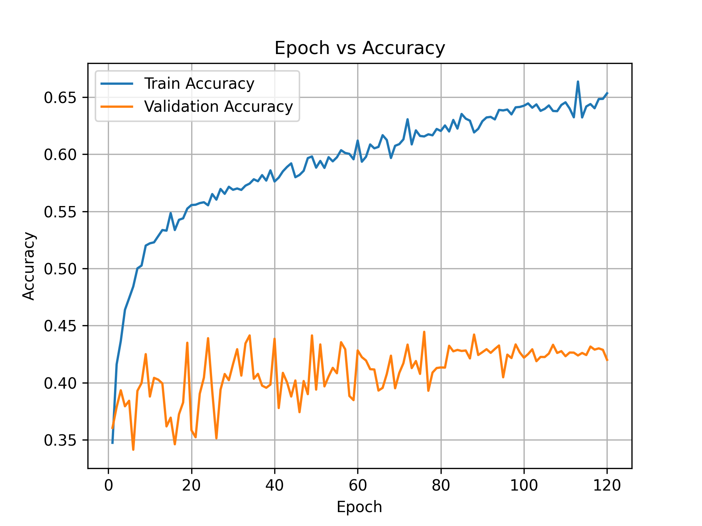
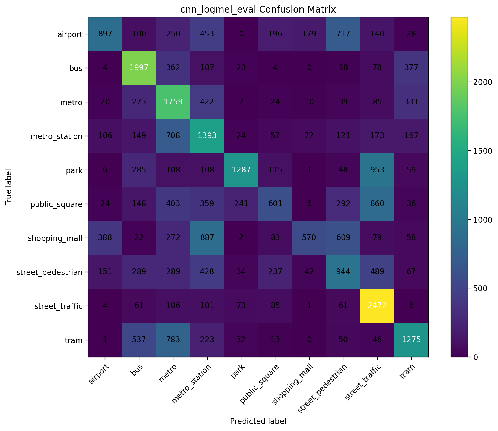

# Audio Scene Classification using AI

A lightweight convolutional neural network (CNN) that classifies one-second audio clips into 10 urban acoustic scenes, trained on the **TAU Urban Acoustic Scenes 2022 Mobile** development dataset (DCASE 2022, Task 1). The input is a three-channel feature map made from a log-mel spectrogram plus its delta and delta-delta, and the network uses depthwise separable convolutions to keep it small.

**Best result:** 44.46% accuracy (44.45% balanced accuracy) on the evaluation split. See [Important Caveat](#important-caveat) before comparing this number with published baselines.

📄 **Full report:** [Audio_scene_classification_using_AI_report.pdf](Audio_scene_classification_using_AI_report.pdf) (graduate project, Spring 2026)

---

## Scene Classes

`airport` · `bus` · `metro` · `metro_station` · `park` · `public_square` · `shopping_mall` · `street_pedestrian` · `street_traffic` · `tram`

## Dataset

- **TAU Urban Acoustic Scenes 2022 Mobile, Development dataset** (Tampere University), 64 hours of audio cut into 1-second clips, recorded in European cities
- Recorded with 3 real devices (A, B, C) and 6 simulated devices (S1–S6)
- Download: [zenodo.org/records/6337421](https://zenodo.org/records/6337421) (about 27.5 GB)
- The dataset is **not included** in this repository. Check its license on Zenodo before reusing it.
- Official fold split used here: **139,620** training clips and **29,680** evaluation clips

## Method

**Preprocessing**
- Resample to 44.1 kHz; pad or crop every clip to exactly 1 second
- 128-bin log-mel spectrogram (STFT with Hann window)
- Add delta and delta-delta, then stack into a 3-channel input of shape `(3, 128, T)`
- Per-sample, per-channel z-score normalization

**Model**
- Depthwise separable convolution blocks with BatchNorm, ReLU, and max pooling
- Global average pooling followed by fully connected layers and a 10-way output

**Training**

| Setting | Value |
|---|---|
| Optimizer | Adam, learning rate 1e-3, with weight decay (L2) |
| Schedule | Cosine annealing over 120 epochs |
| Loss | Cross-entropy with label smoothing 0.1 |
| Batch size | 64 |
| Augmentation | Time shift, gain and additive noise, SpecAugment, Mixup (α = 0.2, probability 0.5) |
| Checkpointing | Best validation accuracy (epoch 76) plus final epoch |

No hyperparameter search was performed.

## Results

| Metric | Value |
|---|---|
| Accuracy | 44.46% |
| Balanced accuracy | 44.45% |
| Test loss | 1.7441 |
| Training accuracy (epoch 120) | about 65.3% |
| Best checkpoint | Epoch 76 |

### Per-class performance

| Class | Precision | Recall | F1 |
|---|---|---|---|
| airport | 56.0% | 30.3% | 39.3% |
| bus | 51.7% | 67.2% | 58.5% |
| metro | 34.9% | 59.2% | 43.9% |
| metro_station | 31.1% | 46.9% | 37.4% |
| park | 74.7% | 43.3% | 54.8% |
| public_square | 42.5% | 20.2% | 27.4% |
| shopping_mall | 64.7% | 19.2% | 29.6% |
| street_pedestrian | 32.6% | 31.8% | 32.2% |
| street_traffic | 46.0% | 83.2% | 59.2% |
| tram | 53.0% | 43.1% | 47.5% |
| **Macro average** | **48.7%** | **44.5%** | **43.0%** |

### Per-device accuracy

| Device | Type | Accuracy |
|---|---|---|
| a | real | 59.4% |
| b | real | 42.4% |
| c | real | 51.7% |
| s1 | simulated | 41.9% |
| s2 | simulated | 42.6% |
| s3 | simulated | 45.1% |
| s4 | simulated | 39.6% |
| s5 | simulated | 41.4% |
| s6 | simulated | 36.1% |

Device A reaches 59.4%, while the weakest simulated device (s6) reaches 36.1%. The gap points to a **domain mismatch**: the model partly relies on microphone characteristics rather than only on the scene. In the official split, devices S4–S6 appear only in the evaluation data, so the model never sees them during training.

### Figures

**Training and validation accuracy over 120 epochs**



**Confusion matrix (evaluation split)**



### What the model confuses

- **Transport scenes** (bus, metro, metro_station, tram) share low-frequency mechanical noise and reverberation, and are often mixed up.
- **Outdoor scenes** (public_square, street_pedestrian, park) overlap in diffuse crowd and ambient noise. Public square is the hardest class.
- **Shopping mall** has decent precision but very low recall. Many mall clips are predicted as metro_station or airport, which also have strong reverberation and crowd noise.
- **Street traffic** is the easiest class, with 83.2% recall.

## Important Caveat

The official split provides only two subsets. The **same 29,680-clip evaluation split was used both to pick the best checkpoint and to report the final result**, and there is no independent held-out test set. The `eval` and `test` result files in this repository are therefore identical. The reported accuracy is a validation score, likely somewhat optimistic, and should not be read as performance on fully unseen data.


## Future Work

- Hold out a truly independent test set, or use cross-validation across all official folds
- Aggregate predictions over longer audio or multiple overlapping one-second windows
- Reduce device dependence with frequency-response normalization or domain-adversarial training
- Try pretrained audio models (for example PANNs or AudioMAE) and test-time augmentation

## Citation

If you use the dataset, please cite:

```
T. Heittola, A. Mesaros, and T. Virtanen,
"TAU Urban Acoustic Scenes 2022 Mobile, Development dataset,"
Zenodo, 2022. DOI: 10.5281/zenodo.6337421
```

